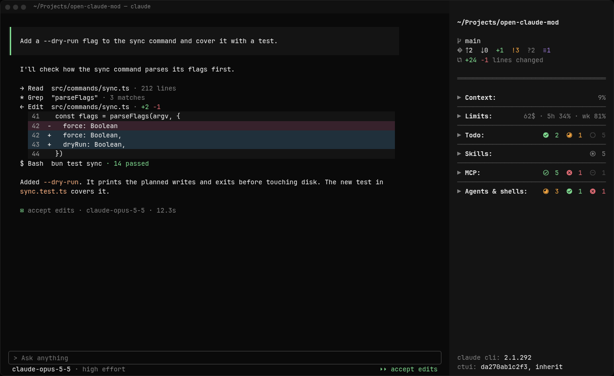
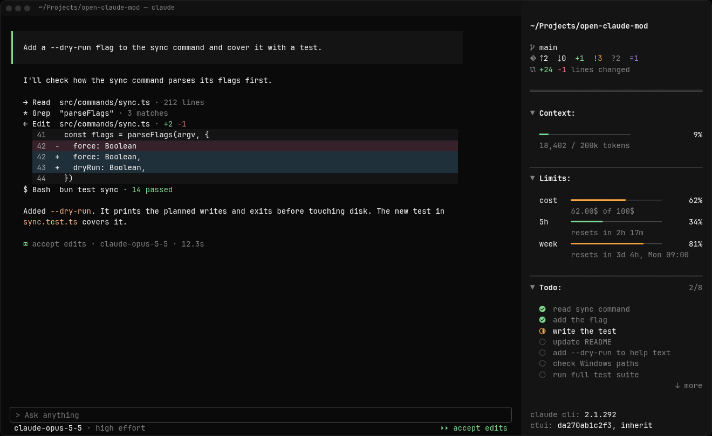
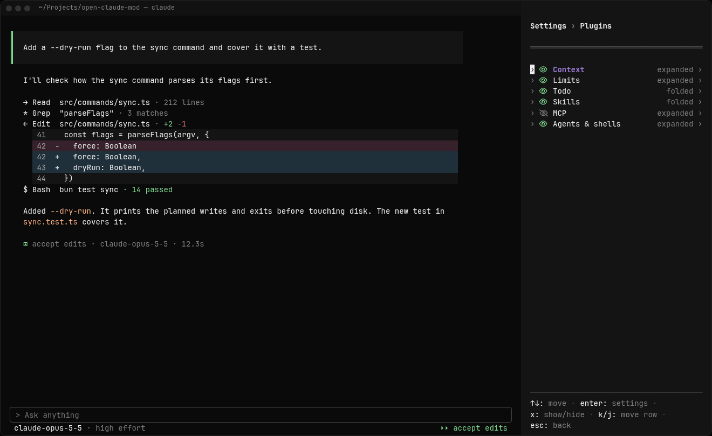
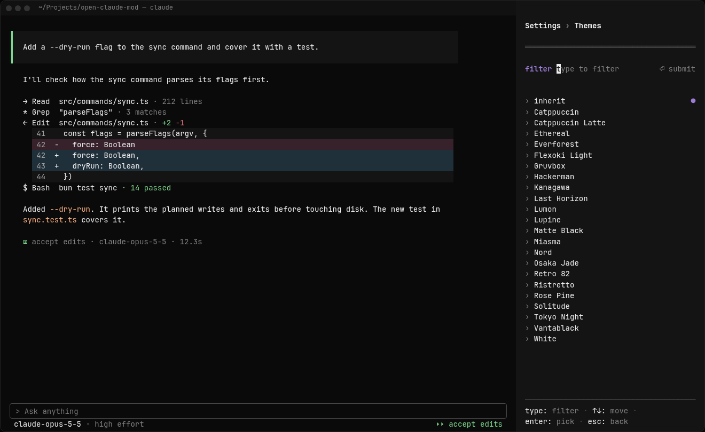

# ctui

A [mod](https://code.claude.com/docs/en/plugins/mods/overview) for Claude Code, built around a sidebar docked beside the transcript.





The sidebar folded and expanded. ctui also restyles the Read, Edit and Bash rows in the transcript and the `model · effort` line under the prompt.





`/ctui` opens the settings menu: turn sidebar sections on or off, reorder them, change each one's settings, and pick a theme.

## Install

Needs Claude Code 2.1.292 or later. Tested with 2.1.300.

```text
/plugin marketplace add a1exk-dev/claude-tui
/plugin install ctui@claude-tui
```

The sidebar docks only in fullscreen, in a terminal 110 or more columns wide. Terminal setup, commands and the task tools are in [`ctui/README.md`](ctui/README.md).

## Docs

- [`ctui/README.md`](ctui/README.md): what ctui does and how to set it up.
- [`docs/configuration.md`](docs/configuration.md): every setting, and the known differences from the renders.
- [`ctui/CHANGELOG.md`](ctui/CHANGELOG.md): what each release changed.

## Developing

- [`CONTRIBUTING.md`](CONTRIBUTING.md): setup, checks, tests and live checks.
- [`docs/adr/`](docs/adr/): the decisions behind the sidebar's design.

## License

MIT. See [LICENSE](LICENSE). The bundled Themes are generated from [Omarchy](https://github.com/basecamp/omarchy)'s palettes, also MIT-licensed; that notice is in [`ctui/LICENSE`](ctui/LICENSE).
